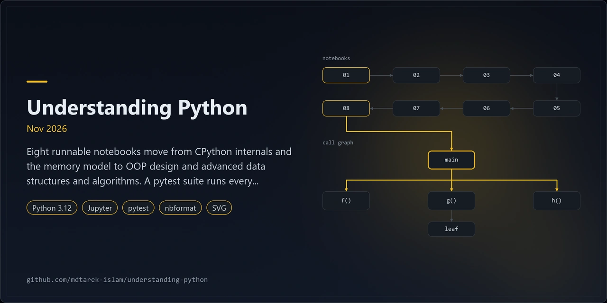
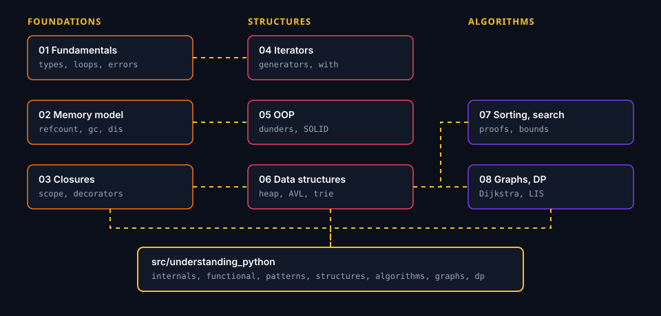
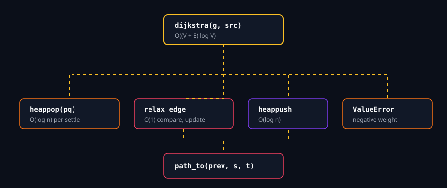

<p align="center"></p>

# understanding-python

## 1. Overview
Eleven executable notebooks teach how Python works inside, from the memory model to dynamic programming.
They run in order: core mechanics, then objects and concurrency, then data structures, then algorithms.
Every concept has four parts: how it works under the hood, production use cases, a trade-off table, and runnable code with printed output.
A tested package, `understanding_python`, holds the implementations the notebooks import.
The curriculum targets Python 3.13 and was built over Feb 2026 to Apr 2026.

### What Python actually is
Python is a language specification. CPython is the reference implementation most people run.
CPython does not turn your code into machine code. It works in two steps:

1. The compiler parses source into an abstract syntax tree, then emits **bytecode** for a stack machine. It caches the result in `__pycache__/*.pyc`.
2. The **virtual machine** is the evaluation loop, written in C. It reads one bytecode instruction at a time and runs it against objects on the heap.

Since 3.11 the VM rewrites hot instructions into specialised forms such as `BINARY_OP_ADD_INT`. Notebook 01 shows this with `dis`.
Every value is an object with a reference count and a type pointer. That design buys flexibility and costs speed and memory.

| | CPython | C | C++ | Rust | Assembly |
|---|---|---|---|---|---|
| Execution | Bytecode run by a VM | Ahead-of-time native code | Ahead-of-time native code | Ahead-of-time native code | Direct machine instructions |
| Memory | Reference counting plus a cyclic collector | Manual `malloc` and `free` | Manual, plus RAII destructors | Ownership and borrowing checked at compile time | Fully manual |
| Pointers | Hidden: names refer to objects | Raw pointers, pointer arithmetic | Raw pointers, references, smart pointers | Safe references, raw pointers in `unsafe` | Raw addresses and registers |
| Registers | None: values live on a stack in memory | Compiler allocates registers | Compiler allocates registers | Compiler allocates registers | You choose each register |
| Typical speed | 10 to 100 times slower than C on tight loops | Baseline | Baseline | Baseline | Baseline or better, with great effort |
| Strength | Productivity, huge ecosystem | Control, tiny runtime | Control with abstraction | Safety with control | Total hardware access |

Python reaches native speed by handing hot loops to C, C++ or Rust libraries: NumPy, PyTorch, Polars, `orjson`.
The Python layer orchestrates. The compiled layer computes.

**Where Python fits**
- **AI and machine learning:** model code, training loops and data loaders.
- **Backend APIs:** web services built on Django, Flask or FastAPI.
- **Data engineering:** pipelines, schedulers and SQL tooling.
- **Automation:** scripts, testing, infrastructure and operations.
- **Scientific computing:** simulation, statistics and notebooks.

**Python in production systems.** Each link leads to the project's own site or engineering blog.

| System | How Python appears | Link |
|---|---|---|
| Instagram | Django web backend on CPython; the team published work on tuning the garbage collector | [Instagram Engineering](https://instagram-engineering.com/) |
| Spotify | Backend services and data pipelines; created the Luigi workflow engine | [Spotify Engineering](https://engineering.atspotify.com/) |
| Netflix | Data science and ML workflows; created Metaflow | [Netflix Tech Blog](https://netflixtechblog.com/) |
| Dropbox | Large server and desktop client codebase in Python | [Dropbox Tech](https://dropbox.tech/) |
| Stripe | Publishes an official Python SDK for its API | [stripe-python](https://github.com/stripe/stripe-python) |
| Reddit | Original site written in Python; the archived `r2` code is public | [reddit-archive](https://github.com/reddit-archive/reddit) |
| YouTube | Early backend services were written in Python | [YouTube blog](https://blog.youtube/) |
| FastAPI | Python web framework built on type hints and Starlette | [fastapi.tiangolo.com](https://fastapi.tiangolo.com/) |
| PyTorch | Python front end over a C++ tensor core | [pytorch.org](https://pytorch.org/) |

## 2. Architecture


Notebooks import from `src/understanding_python/`. Unit tests cover the package. A second test executes every notebook.
The graph notebook builds on a Dijkstra call structure, shown below.



Worker functions for `multiprocessing` live in `concurrency.py`. A spawned process must import them from a module.

## 3. Features
1. CPython internals: object model, reference counting, interning, the cyclic collector, bytecode and specialisation.
2. Typing: PEP 695 generics, bounds, constraints, type aliases and structural `Protocol` contracts, checked with mypy.
3. Iterators, generators, closures, decorators and context managers, with overhead measured.
4. Dunder protocols, descriptors, dataclasses, `__slots__` and four design patterns, with memory measured.
5. Concurrency with timing evidence: the GIL, threads, processes and `asyncio`.
6. Arrays, hash tables, LRU cache, BST, AVL tree, heaps, tries and union-find implemented by hand.
7. BFS, DFS, Dijkstra, A*, topological sort and Kruskal on a UK road network and a grid maze.
8. Dynamic programming and `timeit` benchmarks with fitted growth exponents and Matplotlib plots.

## 4. Quick start
Install Python 3.13 first. Clone the repository, then run the steps for your shell from the repository root.

### Windows PowerShell
```powershell
py -3.13 -m venv .venv
.\.venv\Scripts\Activate.ps1
python -m pip install --upgrade pip
python -m pip install -e ".[dev]"
python -m ipykernel install --sys-prefix --name python3
pytest -q tests/test_units.py tests/test_modules.py
jupyter lab notebooks/
```
If activation is blocked, run `Set-ExecutionPolicy -Scope Process -ExecutionPolicy Bypass` first.

### Windows Git Bash
```bash
py -3.13 -m venv .venv
source .venv/Scripts/activate
python -m pip install --upgrade pip
python -m pip install -e ".[dev]"
python -m ipykernel install --sys-prefix --name python3
pytest -q tests/test_units.py tests/test_modules.py
jupyter lab notebooks/
```

### macOS (Terminal with Homebrew)
```bash
brew install python@3.13
python3.13 -m venv .venv
source .venv/bin/activate
python -m pip install --upgrade pip
python -m pip install -e ".[dev]"
python -m ipykernel install --sys-prefix --name python3
pytest -q tests/test_units.py tests/test_modules.py
jupyter lab notebooks/
```

Run `pytest -q` with no arguments to include notebook execution. It takes several minutes.

## 5. Configuration
1. Python 3.13 only: `requires-python = ">=3.13,<3.14"`. CI uses 3.13.
2. Notebooks use PEP 695 syntax, `itertools.batched` and `sys._is_gil_enabled()`. Older versions fail on purpose.
3. The package has no runtime dependencies. Dev extras add pytest, Jupyter, Matplotlib and mypy.
4. Notebooks add `src/` to `sys.path`, so they run without installation. The kernel name is `python3`.
5. Benchmarks use fixed seeds. Absolute times differ by machine, so read the ratios and fitted slopes.
6. Each notebook finishes in under two minutes on a laptop.

## 6. Usage
```python
from understanding_python.pathfinding import astar, haversine_km, uk_road_graph, CITY_COORDS

roads = uk_road_graph()
goal = "Glasgow"
cost, path, expanded = astar(
    lambda city: roads[city],
    "London",
    goal,
    lambda city: haversine_km(CITY_COORDS[city], CITY_COORDS[goal]),
)
print(cost, path, expanded)
```
Read the notebooks in order, 01 to 11. Re-run one with:
```bash
jupyter nbconvert --to notebook --execute --inplace notebooks/09_graphs_and_shortest_paths.ipynb
```

| # | Notebook | Concepts | Evidence printed |
|---|---|---|---|
| 01 | `01_memory_model_and_mutability` | Names, mutability, copies, refcount, GC, interning, bytecode | Reference counts, object sizes, `dis` output |
| 02 | `02_typing_generics_protocols` | Annotations, PEP 695 generics, Protocols | mypy reports, type parameters |
| 03 | `03_iterators_and_generators` | Iterator protocol, generator frames, lazy pipelines | Peak memory of eager and lazy code |
| 04 | `04_decorators_and_context_managers` | Closures, decorators, `with`, `ExitStack` | Wrapper overhead in nanoseconds |
| 05 | `05_oop_dunders_dataclasses_patterns` | Dunders, dataclasses, `__slots__`, descriptors, patterns | Bytes per object |
| 06 | `06_concurrency_gil_asyncio_processes` | GIL, threads, processes, `asyncio` | Speed-up of each model |
| 07 | `07_arrays_and_hash_tables` | Dynamic arrays, dict internals, LRU cache | Resize traces, hit rates |
| 08 | `08_trees_heaps_tries` | BST, AVL, heaps, top-k, tries | Tree heights, lookup times |
| 09 | `09_graphs_and_shortest_paths` | BFS, DFS, Dijkstra, A*, topological sort, MST | Node expansions, routes |
| 10 | `10_dynamic_programming` | Memoisation, tabulation, knapsack, LCS | Call counts, brute-force checks |
| 11 | `11_complexity_benchmarks` | Big-O fits, container costs, sorting | Log-log plots, fitted slopes |

## 7. Licence and contribution
MIT licence. See `LICENSE`. Open an issue before a large change. Add a test with every new function.
Keep prose in British English, with no dashes and no filler. Keep notebook output visible after a run.

## 8. Maintenance status
Maintained. The curriculum is complete and tested on Python 3.13. Fixes and version updates follow as needed.
